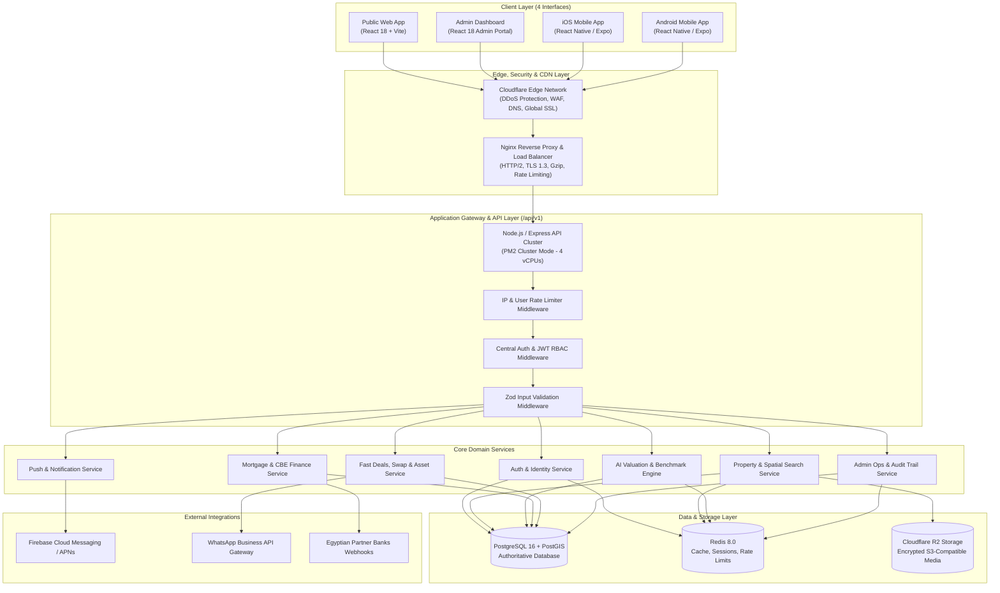

# AQAR IN — Target Platform Architecture Blueprint

**Target Ecosystem:** Web Application, Admin Dashboard, Native iOS, Native Android, Centralized API & Database  
**Author:** Lead Software Architect & Principal Engineer  
**Version:** 2.0.0-PROD  
**Database Standard:** **PostgreSQL 16 + PostGIS (Authoritative Data Source)**  
**Status:** Approved Architectural Blueprint

---

## 1. Unified Platform Architecture & Vision

AQAR IN is expanding into a complete, enterprise-grade real-estate ecosystem serving four distinct client interfaces:

1. **Public Web Application (React 18 SPA):** Consumer portal for discovery, search, valuation, and mortgage tools.
2. **Admin Control Panel (Dedicated React SPA):** Enterprise management interface for operational metrics, property moderation, benchmark tuning, and user management.
3. **Native iOS Application (React Native / Expo):** High-performance native mobile experience with biometrics, push notifications, and offline caching.
4. **Native Android Application (React Native / Expo):** Feature-equivalent native Android application.

All four clients communicate exclusively with a single, authoritative, versioned **Backend API Gateway (`/api/v1`)**. **PostgreSQL 16 with PostGIS** serves as the sole authoritative data store. No client possesses direct database access or bypasses business rules.

---

## 2. Complete System Architecture Diagram (Mermaid)



---

## 3. Standardized API Architecture & Contracts (`/api/v1`)

### 3.1. API Versioning Strategy
All endpoints are unified under `/api/v1`:
```text
/api/v1/auth/*           # Authentication, Token refresh, Identity
/api/v1/properties/*     # PostGIS radius search, bounding-box map, listing details
/api/v1/valuation/*      # Instant AI Valuation, certified appraisal requests
/api/v1/mortgage/*       # CBE 3%/8% calculator, pre-approvals, bank routing
/api/v1/services/*       # Fast Buy, Fast Sell, Exchange, Finishing, Management
/api/v1/leads/*          # Property inquiries, viewing bookings, partner applications
/api/v1/admin/*          # RBAC-secured admin operations, benchmark tuning, audits
/api/v1/media/*          # Presigned Cloudflare R2 direct upload URLs
```

### 3.2. Standardized Response Envelope
Every endpoint returns a predictable JSON response structure across Web, Admin, and Mobile:

#### Success Response Contract:
```json
{
  "success": true,
  "statusCode": 200,
  "message": "Properties retrieved successfully",
  "data": [ ... ],
  "meta": {
    "page": 1,
    "limit": 20,
    "totalItems": 142,
    "totalPages": 8,
    "hasNextPage": true,
    "hasPrevPage": false
  }
}
```

#### Error Response Contract (RFC 7807 Standard):
```json
{
  "success": false,
  "statusCode": 400,
  "error": {
    "code": "VALIDATION_ERROR",
    "message": "Invalid property submission data",
    "details": [
      { "field": "price", "message": "Price must be a positive integer" },
      { "field": "area_sqm", "message": "Area in square meters must be between 20 and 5000" }
    ]
  },
  "timestamp": "2026-10-29T10:00:00Z",
  "path": "/api/v1/properties"
}
```

---

## 4. Centralized Authentication & Access Control

### 4.1. Dual-Token Security Lifecycle
* **Access Token:** Short-lived JWT (15 minutes). Contains `userId`, `role`, and `permissions`. Signed with `RS256` or strong `HS256` secret.
* **Refresh Token:** Cryptographically random 64-character token stored with a hashed signature in Redis / PostgreSQL. Expires in 30 days. Supports instant revocation upon user logout or password change.

### 4.2. Role-Based Access Control (RBAC)
Enforced strictly at the API Gateway level:
* **`buyer`:** Discovery, saved favorites, valuations, mortgage requests, leads.
* **`seller`:** All buyer rights + submit property listings (defaults to `pending_review`).
* **`agent`:** Manage assigned listings and viewing schedules.
* **`admin`:** Moderate listings, update benchmarks, review mortgage/service leads.
* **`super_admin`:** Full access, user role assignments, audit logs, and infrastructure controls.

---

## 5. PostGIS Geospatial Engine Integration

The backend leverages PostgreSQL PostGIS natively for all map-based operations:
1. **Interactive Map Exploration:** Viewport bounding boxes (`location_geog && ST_MakeEnvelope(...)`) return pins in < 10ms.
2. **Proximity Search:** `ST_DWithin` filters properties within exact kilometer radius from user location or selected landmark using unit-safe meter calculations.
3. **Future Custom Polygon Search:** Allows users on Web and Mobile to draw custom freehand shapes on the map to filter listings.
